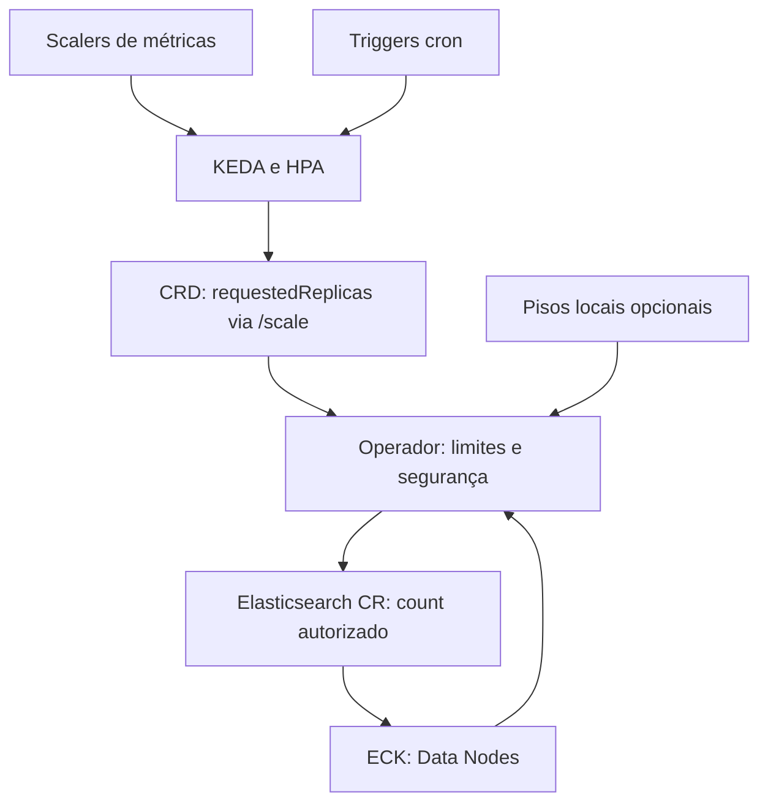

# ElasticsearchQueueAutoscaler

Operator em Go para aumentar Data Nodes do Elasticsearch gerenciado pelo ECK. **KEDA é o provider principal de demanda**, usando o subrecurso Kubernetes `/scale` da nossa CRD. KEDA coleta métricas e combina triggers; este operador valida segurança e aplica o count no ECK.

**MVP v0.2.0 / API v1alpha1. Somente scale up. Audit por padrão.** Não depende do ElasticsearchAutoscaler Enterprise e não escreve em StatefulSets, PVCs ou réplicas de índices. Licença Apache-2.0; as licenças ECK/Elasticsearch continuam aplicáveis.

## Fluxo e responsabilidades



O operador não acessa Pub/Sub, Google Monitoring ou Datadog diretamente. Essas fontes podem ser configuradas como scalers do KEDA, com autenticação administrada no KEDA. Não é necessário webhook nem um custom scaler para usar a CRD.

```text
recomendação = max(minReplicas, requestedReplicas do KEDA, pisos locais ativos)
desejado = max(count atual, min(maxReplicas, count atual + maxStep, recomendação))
```

Os triggers cron e de métricas do ScaledObject são combinados pelo KEDA/HPA. Se uma janela pedir 5 e uma métrica pedir 8, vale a maior recomendação, sujeita aos limites/estabilização. Encerrar a janela ou diminuir a demanda nunca remove nós no MVP. Um único ScaledObject deve escrever em cada autoscaler.

## Implementado

- CRD tipada Kubebuilder/controller-runtime com subrecursos `/status` e `/scale`.
- Contrato KEDA: `spec.requestedReplicas`, `status.replicas` observado em Pods e `status.selector` exclusivo do NodeSet.
- Segurança ECK/Pods, saúde, realocação, disco e shards; autorização explícita por Elasticsearch/NodeSet.
- Autorização por NodeSet, coordenação entre duas políticas e diagnóstico ScaleStalled sem rollback automático. Hosts distintos são uma proteção opcional.
- Lease, JSON Patch com resourceVersion, cooldown persistido e bloqueio enquanto o scaling anterior não convergir.
- Estabilização que não reinicia a cada atualização de demanda do HPA.
- Audit, DryRun de API server e Auto; logs, eventos e Prometheus.
- Pisos locais semanais opcionais, fuso IANA e sobreposição por máximo. O exemplo principal usa cron do KEDA.
- Testes unitários, reconciliação e envtest com `/scale` real; Helm, Dockerfile, Makefile e GitHub Actions.

Scale down, tracing OpenTelemetry e instalação automática do KEDA não estão implementados. Métricas Prometheus podem ser coletadas pelo OpenTelemetry Collector. O nome do projeto foi preservado para manter continuidade do repositório.

## Instalação

1. Instale ECK e KEDA separadamente. Disponibilize Elasticsearch estável, Pods/PVCs e capacidade Kubernetes. Os exemplos KEDA seguem o contrato documentado em 2.21; homologue a versão instalada.
2. Configure API key Elasticsearch com privilégio de cluster `monitor` e de índices `monitor` para `/_cat/shards`, sem privilégios de escrita. A visão de shards deve cobrir todos os índices do cluster, inclusive restritos quando existentes; veja [credenciais](docs/local-lab.md#credenciais-e-keda-customizado). Monte o campo `encoded` no Secret `eqa-es-monitor`, chave `api-key`; monte a CA pública ECK.
3. Faça build/publicação da sua imagem antes do deploy. O repositório contém pipeline de release, mas não pressupõe uma imagem v0.2.0 já publicada.
4. Revise `targetNames`, imagem, namespace e permissões. Uma instalação por namespace e uma CR por NodeSet autorizado; múltiplos NodeSets podem compartilhar o mesmo Elasticsearch, com operações serializadas. Uma CA/API key é configurada por instalação.

```bash
make verify
make docker-build IMG=ghcr.io/thallesdaniell/elasticsearch-queue-autoscaler:v0.2.0
# Publique a imagem no registro antes de instalar.
kubectl create namespace elastic-system
kubectl -n elastic-system create secret generic eqa-es-monitor \
  --from-file=api-key=/CAMINHO_PROTEGIDO/api-key
kubectl apply -f config/crd/bases
helm upgrade --install eqa charts/elasticsearch-queue-autoscaler \
  --namespace elastic-system --set image.tag=v0.2.0
kubectl apply -f config/samples/autoscaler.yaml
# Ajuste endereço, query e autenticação do scaler antes deste passo:
kubectl apply -f config/samples/scaledobject.yaml
```

O Helm não instala KEDA, não cria ScaledObject e não atualiza CRDs existentes automaticamente. `config/install.yaml` é a alternativa renderizada ao Helm, não uma segunda instalação concorrente. Para repositórios de imagem privados, configure acesso ao registry no cluster.

## Ownership e segurança

O Elasticsearch deve autorizar explicitamente o alvo:

```yaml
metadata:
  annotations:
    queue-autoscaler.io/owners: '{"hot-data":"search-queue"}'
```

Para dois NodeSets, use um mapa como `{"data-contacts":"search-contacts","data-perc":"search-percolate"}` e uma CR/ScaledObject para cada entrada. Veja [exemplo](config/samples/two-nodesets.yaml). As annotations legadas owner/node-set continuam aceitas quando owners não existe.

Declare `node.roles` com `data`/`data_*` e sem `master`. O alvo fica no mesmo namespace da CR. `targetRef` é imutável. Nunca aponte o ScaledObject para o StatefulSet ECK ou para o Deployment deste operador.

KEDA/HPA escreve somente a demanda; o operador escreve o count autorizado. Configure [ArgoCD](config/samples/argocd.yaml) para ignorar `/spec/requestedReplicas` da nossa CR, apenas o count do NodeSet escolhido e as annotations operacionais no Elasticsearch, com `RespectIgnoreDifferences=true`.

Veja [RBAC suplementar](config/samples/keda-rbac.yaml) para instalações KEDA restritas. Confirme as identidades reais do KEDA e do HPA; não aplique o exemplo cegamente. O operador não recebe permissão de escrita em `/scale`.

## Operação

```bash
kubectl -n elastic-system get elasticsearchqueueautoscalers
kubectl -n elastic-system get hpa
kubectl -n elastic-system describe scaledobject search-demand
kubectl get --raw /apis/autoscaling.queue-autoscaler.io/v1alpha1/namespaces/elastic-system/elasticsearchqueueautoscalers/search-queue/scale
kubectl -n elastic-system patch elasticsearchqueueautoscaler search-queue \
  --type=merge -p '{"spec":{"mode":"DryRun"}}'
# Após homologação e suspensão dos writers antigos:
kubectl -n elastic-system patch elasticsearchqueueautoscaler search-queue \
  --type=merge -p '{"spec":{"mode":"Auto"}}'
# Pausar novos patches no ECK:
kubectl -n elastic-system patch elasticsearchqueueautoscaler search-queue \
  --type=merge -p '{"spec":{"mode":"Audit"}}'
```

Audit/DryRun permitem observar a demanda do KEDA sem persistir count no ECK. Ambos escrevem status/eventos. Trocar para Audit não cancela um patch já enviado. Pausar somente KEDA **não pausa o operador**: a última demanda persistida pode continuar sendo aplicada em passos. Para suspender atuação, use Audit.

`currentReplicas` é o count configurado no ECK; `replicas` conta Pods não terminando do NodeSet e alimenta `/scale`; `readyReplicas` conta os prontos; `desiredReplicas` é a decisão após limites. Esses números podem divergir durante scaling.

O contrato `/scale` não traz timestamp da métrica. A demanda é uma intenção persistida, não uma amostra com TTL. O operador não promete bloquear um pedido já aceito quando a fonte/KEDA ficar indisponível. Configure qualidade/freshness das métricas no scaler, limites de custo e alertas. A política anterior de erro de Monitoring bloquear todo o ciclo foi removida com o provider direto. Veja [ADR 0004](docs/adr/0004-keda-primary-provider.md).

## Desenvolvimento e documentação

Baseline: Go 1.24.7, controller-runtime 0.20.4, Kubernetes libs 0.32.x, envtest 1.32.0, Helm 3.17.3. Execute `make verify`. Envtest precisa baixar API server/etcd e não executa KEDA, HPA, ECK ou Elasticsearch reais.

[Especificação e gates de adoção](docs/SPEC.md) · [Sinais](docs/signals.md) · [Integração KEDA](docs/keda.md) · [Arquitetura](docs/architecture.md) · [Composição](docs/providers.md) · [Migração](docs/migration.md) · [Runbook](docs/runbook.md) · [Validação](docs/validation.md) · [Segurança](SECURITY.md)

## Local KEDA laboratory

Run `make local-up`, then `make local-test` with Docker Compose v2 and Python 3.10+.
The disposable K3s cluster runs real KEDA/HPA, ECK, Elasticsearch and Prometheus;
only backlog demand is synthetic. See [setup, credentials, scenarios and validation limits](docs/local-lab.md).
Use `make local-down` to delete this lab and its data.
