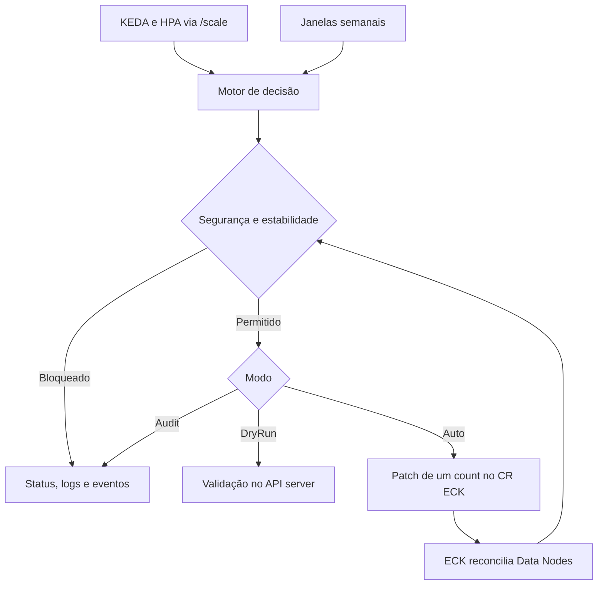

# Arquitetura e riscos

## Fluxo

## Fronteiras

O engine calcula demanda; o controller aplica política; ECK executa a mudança. Nunca usamos Scale subresource de StatefulSet, HPA diretamente sobre Pods ECK, API Enterprise ou edição da lista inteira de NodeSets. O API client usa Unstructured para manter o acoplamento ao contrato Elasticsearch v1, preservando campos desconhecidos.

## Ordem da reconciliação

1. Leitura direta e atual do CR, validação de spec e cancelamento se estiver sendo excluído.
2. Leitura direta do Elasticsearch; autorização por nome do CR/NodeSet; validação de roles.
3. Verificação de pending-count, observedGeneration, phase Ready e Pods prontos de todos os NodeSets.
4. Leitura HTTPS de health, filesystem por nó e shards. Qualquer erro bloqueia.
5. Leitura de requestedReplicas e pisos locais, composição por máximo e limites de réplica/passo.
6. Cooldown persistido no alvo e estabilização persistida no status. Durante a janela, a recomendação executável é o piso sustentado, não um pico recente.
7. Nova leitura da política para detectar mudança de generation/UID/exclusão.
8. Audit retorna decisão; DryRun valida patch sem persistência; Auto aplica patch JSON com testes de resourceVersion, nome do NodeSet e count anterior.
9. Status, métricas, eventos e requeue. Erros de patch não são repetidos cegamente: o próximo ciclo lê tudo e decide novamente.

Uma falha depois do patch e antes do status não apaga o cooldown: last-scale, pending-count, pending-node-set e cooldown-until entram na mesma transação do count no Elasticsearch. Um count revertido abaixo do último pending-count bloqueia novas mutações e exige investigação. Pending-count é um marcador persistente; não é removido automaticamente quando converge.

## Concorrência

Todas as réplicas na mesma namespace disputam a mesma Lease. Só um reconcile é executado por vez. Um Elasticsearch autoriza múltiplas CRs pelo mapa owners, uma por NodeSet. Uma operação pendente bloqueia todas elas até convergência. Outros processos ainda podem editar o alvo; resourceVersion evita aplicar uma decisão sobre um snapshot alterado. Uma alteração posterior à leitura de segurança sempre é possível em sistemas distribuídos: os critérios reduzem risco, não fornecem uma transação entre Elasticsearch e Kubernetes.

O CR é imutável em targetRef, mas uma troca de modo pode concorrer com um patch já em trânsito. Audit é pausa de decisões futuras, não cancelamento transacional de requisições já autorizadas.

## Riscos técnicos

| Risco | Controle | Limite remanescente |
|---|---|---|
| Backlog causado por consumidores ou dependências | Max replicas, step, estabilização e Audit | Exige calibração e evidência do gargalo |
| KEDA/fonte indisponível | Alertas e Audit para pausa | A última demanda é persistente e não expira |
| Métrica atrasada no scaler | Freshness na query/origem KEDA | /scale não transporta timestamp |
| Rebalanceamento degrada escrita | Health, ausência de shards em movimento, passo pequeno | Adição de nós ainda movimenta dados |
| Capacidade GKE/PVC indisponível | Pods não convergidos bloqueiam próximo aumento | Não provisiona capacidade física |
| Disco/shards acima dos limites | Bloqueia qualquer patch | Pode exigir scale up manual para recuperação |
| ECK status eventualmente consistente | Generation + Pods por NodeSet + health direto | Não elimina toda corrida externa |
| ArgoCD restaura count | ignoreDifferences + RespectIgnoreDifferences | Precisa teste na versão de ArgoCD utilizada |
| Criação/exclusão de alvo por terceiros | RBAC, annotations e CAS | Administradores permanecem confiáveis |
| Rotação de certificados | CA explícita, TLS validado | CA é carregada no startup; exige rollout |
| API de shards grande | Leitura limitada a 16MiB, timeout | Falha fechada; requer evolução para clusters enormes |

## Observabilidade

`eqa_decisions_total{reason}` e `eqa_replicas{namespace,autoscaler,kind}` acompanham decisões e contagens. Controller-runtime expõe métricas de duração/erros/fila; processo Go expõe runtime. Events ocorrem quando a mensagem muda; logs registram cada decisão. Labels nunca incluem mensagens da fila, erro livre ou credenciais.

O endpoint não usa TLS/autenticação de aplicação; o chart limita acesso por NetworkPolicy. Para OpenTelemetry, use Prometheus receiver. Tracing não está implementado. Séries de autoscalers removidos permanecem no registry até o restart; não use nomes descartáveis sem limite de cardinalidade.

## Referências oficiais consultadas

* https://www.elastic.co/docs/deploy-manage/deploy/cloud-on-k8s/nodes-orchestration
* https://www.elastic.co/docs/deploy-manage/deploy/cloud-on-k8s/node-configuration
* https://keda.sh/docs/2.21/concepts/scaling-deployments/
* https://kubernetes.io/docs/tasks/extend-kubernetes/custom-resources/custom-resource-definitions/#scale-subresource
* https://argo-cd.readthedocs.io/en/stable/user-guide/sync-options/
* https://book.kubebuilder.io/quick-start

Referências orientam o desenho; a matriz de execução efetiva está em validation.md.

## Contrato de demanda

Veja [KEDA](keda.md) e [ADR 0004](adr/0004-keda-primary-provider.md). A contagem observada em Pods alimenta /scale; count configurado no ECK permanece em currentReplicas. A estabilização usa hash da política excluindo requestedReplicas, evitando que atualizações HPA adiem indefinidamente um aumento sustentado. O operador não sobrescreve requestedReplicas.

## Revisão após os legados

A operação guarda o nome do NodeSet para que outro autoscaler não compare seu próprio count ao marcador alheio. PendingSince persiste espera contínua e convergenceTimeoutSeconds gera ScaleStalled sem qualquer rollback. requireDistinctNodes é opt-in para validar hosts do NodeSet após convergência dos Pods. Metrics incluem requested/observed/ready, heartbeat de decisão e segundos em espera. Veja SPEC.md e ADR 0005.

O cooldown-until gravado pelo writer anterior é respeitado também pelos demais NodeSets, mesmo que tenham cooldownSeconds menor. Para novos patches vale ainda o cooldown da política que está sendo avaliada. Ambos são persistidos/avaliados com o relógio UTC.
